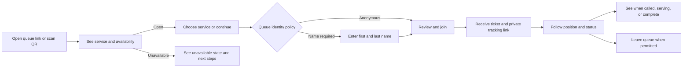

# Visitor flow user stories

## Goal

Let visitors join and follow a queue from a phone browser without installing an app or creating an account. Respect each queue's identity policy: anonymous ticket or first and last name required.

**Behavior reference** — [Phoenix visitor flow user stories](https://github.com/johnwesonga/kewkew/blob/main/docs/visitor-flow-user-stories.md). This document carries those product rules into the Cloudflare rebuild without requiring Phoenix or Ash implementation details. Queue configuration and sessions are covered by [admin queue configuration](admin-queue-configuration-user-stories.md); staff ticket operations are covered by [staff admin flow](staff-admin-flow-user-stories.md). Recurring signup windows and scheduled starts remain a separate Phoenix reference until their Cloudflare story is prepared.

These stories assume an administrator has configured a location, service, queue, identity policy, and session. Staff setup and queue configuration are dependencies, not part of visitor-flow implementation.

**Status tracking** — `Complete` means all acceptance criteria are implemented in this repository; `In progress` means some criteria remain; `Planned` means implementation has not started. Status tracks this Cloudflare repository, not production release.

## Visitor journey

## Shared product rules

- The visitor experience is mobile-first and works in a modern browser without an account or app installation.
- The queue's configured identity policy is authoritative. Ask only for information required by that policy, and enforce the policy on the server.
- Each successful join creates one ticket with a visitor-facing number and a separate unguessable tracking credential. The public tracking URL must not expose a database ID or grant access to another visitor's ticket.
- Store a digest of the private tracking credential; keep the raw credential out of database records and public responses. It must be separate from the ticket number and revocable.
- Ticket numbers start at 1 for each queue session. Pausing and resuming a session do not reset numbering; closing it and opening another session does.
- The persisted ticket state and queue order are authoritative. Queue position is in the initial release. Estimated wait is a nice-to-have and out of scope for the initial release.
- Collect no phone number, email address, or notification consent in the initial join form. Add contact data only through a separately reviewed notification story.
- If a queue becomes unavailable during joining, preserve entered data where safe and explain why the visitor could not join. Never show a successful ticket unless ticket creation committed.
- Same-browser repeat-join prevention uses a separate opaque browser credential scoped to one queue session. Keep the documented development bypass for local work; it must not weaken production enforcement.
- Public queue and tracking responses contain only the minimum information needed by that visitor. Never broadcast or return another visitor's name, contact details, ticket record, or tracking credential.

## Stories

### VF-1: Open a queue from a shared link or QR code

**Status** — Complete

**User story** — As a visitor, I want to open a queue from a link or scanned QR code so I can see where to join without installing an app.

**Acceptance criteria**

- A valid public queue link opens on a phone or desktop browser and shows the organization, location, service, and current signup availability.
- An invalid, deleted, or revoked link shows a clear unavailable page and exposes no queue or visitor data.
- The page identifies the location and service in text, not only through a logo, color, or QR code.
- The page remains usable at narrow mobile widths and with keyboard navigation.

**Implementation note** — `/q/[publicId]` resolves an opaque queue link and displays the organization, location, service, and availability. Malformed and unknown identifiers redirect to a generic unavailable page that reveals no queue data. The public page uses responsive sizing and visible keyboard focus for its links.

### VF-2: Understand whether a queue is open

**Status** — Complete

**User story** — As a visitor, I want to know whether I can join before entering details so I do not waste time on an unavailable queue.

**Acceptance criteria**

- An open queue provides a clear action to continue joining.
- A closed, paused, inactive, or full queue explains that joining is unavailable and does not present an enabled join action.
- If the queue changes state after the page loads, the server rejects a now-invalid join and provides a useful explanation.
- Closed-state copy may include configured reopening information when available; it must not invent an opening time.

**Implementation note** — The public page distinguishes inactive queue, location, and service states, a paused session, and the absence of an open session. It displays an enabled join action only while signup is available, including remaining within configured capacity, and the server rechecks those conditions during submission.

### VF-3: Select a service when a location offers more than one

**Status** — Complete

**User story** — As a visitor, I want to choose the service I need so I join the correct queue.

**Acceptance criteria**

- When multiple services can be joined, each option shows a plain-language service name and useful queue information, such as position where available. Estimated wait is a later enhancement.
- I can select exactly one service before joining.
- A link to one specific queue may skip service selection and show that queue directly.
- A service that is closed or unavailable cannot be selected.

**Implementation note** — A direct queue link opens that queue immediately. When its location has other configured queues, the visitor can expand a service chooser showing each service and queue; only queues with an active queue, location, service, and open session have a selectable link. Unavailable options remain visible without a navigation link. Position and wait estimates are omitted until tickets are implemented.

### VF-4: Join an anonymous queue

**Status** — Complete

**User story** — As a visitor using an anonymous queue, I want to receive a number without sharing my name so I can wait with minimal data collection.

**Acceptance criteria**

- An anonymous queue does not request first name, last name, email, or phone number.
- Confirming the join creates one ticket with the next valid visitor-facing number and returns its private tracking page.
- Invalid queue data or an unavailable queue creates no ticket and produces an actionable error.
- A slow connection, retry, or double tap does not create duplicate tickets for the same join attempt.
- The ticket number is never used as the authorization credential for private tracking.

**Implementation note** — `/q/[publicId]` provides a no-name, no-contact-data join action for anonymous queues. D1 migration `0012_visitor_tickets.sql` adds tickets, event history, private tracking credentials, browser claims, and per-session counters. A conditional session update and D1 batch enforce open-session, active queue/location/service, capacity, and repeat-attempt checks before creating the ticket, initial `waiting` event, tracking credential digest, and browser claim. The returned `/t/[token]` URL is unguessable and its raw token is not stored. A server-side development-only switch (`BROWSER_DUPLICATE_SIGNUP_PREVENTION=false`) bypasses same-browser duplicate prevention for local testing; production ignores that bypass.

### VF-5: Join a queue that requires first and last name

**Status** — Complete

**User story** — As a visitor at a service that matches tickets to people, I want to provide my first and last name so staff can identify me when my number is called.

**Acceptance criteria**

- A queue configured to require a name displays clearly labeled first-name and last-name fields.
- Submitting either required field empty identifies the missing field and creates no ticket.
- The server validates both fields even if a client bypasses the form.
- Successful submission stores the name and confirms the ticket without unnecessarily repeating private details.
- The server reads the identity policy from the selected queue; a client cannot bypass a required name by changing request parameters.

**Implementation note** — The public queue page renders required first- and last-name fields only when the server reports `name_required`. The join action trims and validates both names, preserves entered values and field errors after rejection, rejects names submitted to anonymous queues, and derives policy again from D1. The conditional ticket insert stores the policy and names together; the migration constraint enforces that anonymous tickets have no names and name-required tickets have both nonblank names. Successful confirmation avoids displaying the visitor's name.

### VF-6: Receive a ticket and private tracking page

**Status** — Complete

**User story** — As a visitor who joined successfully, I want a clear ticket confirmation and a private page so I can verify my place and return to it later.

**Acceptance criteria**

- After successful creation, I see my ticket number, service/location, current status, and queue position.
- The page distinguishes the ticket number from the private tracking link or credential.
- Refreshing or reopening the private link reads the same ticket from persisted data.
- A malformed, expired, or revoked token shows an unavailable state without revealing whether other tickets exist.
- The page offers a usable way to copy or share the tracking link; the link is never exposed in a public queue listing.
- Tracking-token lifetime, revocation, and retention behavior are decided before implementation.

**Implementation note** — `/t/[token]` resolves only a valid 32-byte random token by its SHA-256 digest and returns the ticket number, queue/service/location, status, and active queue position. The page sends `no-store` and `no-referrer` headers, provides a copy-link control with accessible feedback, and maps malformed, expired, and revoked credentials to the same generic unavailable page. Tracking credentials expire 90 days after creation and can be revoked server-side; completed tickets retain their receipt page until that expiry. Credential digests remain with the ticket record; ticket-history cleanup is a separate retention decision.

### VF-7: Follow queue position and status changes

**Status** — In progress

**User story** — As a waiting visitor, I want my ticket page to stay current so I know when my turn is approaching.

**Acceptance criteria**

- The page shows the latest persisted ticket status and position among eligible tickets ahead of me.
- Estimated wait is optional. If added later, label it as an estimate and explain when there is insufficient data rather than showing a misleading number.
- When staff call, begin serving, or complete my ticket, the visitor view updates promptly while connected.
- After a disconnect or refresh, the page reloads current persisted state. Polling or refresh is sufficient for the initial implementation; real-time updates are a separate slice.
- Updates never expose another visitor's name, contact details, or private tracking credential.

**Implementation note** — The private ticket page reloads its own server-authorized record every five seconds while waiting, called, serving, or no-show, and refreshes when a visitor returns to the tab. It announces status changes accessibly, shows a position only for active tickets, and presents distinct next steps for called, serving, completed, cancelled, and no-show states. Polling stops for completed and cancelled tickets; no-show remains refreshable because staff may recall it to waiting. This story remains in progress until staff ticket transition actions are implemented and can drive those persisted status changes.

### VF-8: Leave or cancel my place in line

**Status** — Complete

**User story** — As a visitor who can no longer wait, I want to leave the queue so staff do not hold my place unnecessarily.

**Acceptance criteria**

- The private ticket page offers a clearly labeled leave action only when the ticket state allows visitor cancellation.
- The action asks for confirmation before changing the ticket.
- Confirming changes the ticket to a terminal cancelled state and removes it from active queue position calculations.
- Repeating the action is safe and does not create inconsistent state.
- The initial policy permits self-cancellation while waiting. If a ticket has been called or service has started, explain when cancellation is unavailable.

**Implementation note** — The private ticket page offers a confirmed leave action only while the ticket is waiting. The server resolves the ticket through its unexpired, non-revoked tracking credential and conditionally changes only a still-waiting ticket to `cancelled`, writing the visitor event in the same D1 batch. A unique partial index and conditional update make duplicate submissions safe. Called and serving tickets display that visitor cancellation is unavailable and direct the visitor to staff; cancellation removes the ticket from active position and capacity counts.

### VF-9: Understand when I am called

**Status** — In progress

**User story** — As a visitor whose turn has arrived, I want an unmistakable call-to-action on my tracking page so I know what to do next.

**Acceptance criteria**

- When the ticket becomes called, the page presents a prominent called state and a clear next step, using configured service instructions when available.
- The called state remains available after refresh and comes from persisted state, not only a transient browser event.
- If a call expires or is skipped, the page shows the resulting state and next steps without implying the visitor is still being served.
- The page does not depend on sound, color, or push-notification permission to communicate the called state.
- SMS or push notifications are not required for this story.

**Implementation note** — When persisted status is `called`, the private page presents a prominent “Your turn is now” message and directs the visitor to the service desk for their service with their ticket number. The callout is announced assertively to assistive technology and remains backed by persisted state through polling and refresh. A dedicated configurable service-instructions field and staff call/skip actions are not implemented yet, so this story remains in progress. A `no_show` update has distinct next-step copy, and the page continues polling so a later recall is visible.

### VF-10: See a service completion confirmation

**Status** — Planned

**User story** — As a visitor whose service is complete, I want a thank-you confirmation so I know I can leave and stop monitoring my place in line.

**Acceptance criteria**

- When the ticket becomes `completed`, the private tracking page shows a clear thank-you state with the completed ticket and service.
- The completed view hides active-queue controls and information, including position, leave action, and copy-link control.
- The existing private URL continues to show the completion receipt after refresh or reopening; it does not immediately become unavailable or redirect without ticket context.
- The view updates when completion occurs while open and stops polling for queue position afterward.
- The confirmation does not expose additional personal data or imply that the ticket is still active.
- Cancelled and no-show tickets keep distinct status and next-step messages; they are not shown as successful service completion.

## Suggested implementation order

1. **Direct link and availability** — finish VF-1 and VF-2 for one queue per link.
2. **Join and confirmation** — VF-4 and VF-5 with server-side policy enforcement, durable ticket creation, and private tracking credentials (VF-6 core).
3. **Return and track** — remaining VF-6 and VF-7 using persisted state; add live updates after queue operations exist.
4. **Visitor self-service** — VF-8 after cancellation policy is implemented.
5. **Called state and completion** — VF-9 and VF-10 after staff ticket operations exist.
6. **Multi-service discovery** — VF-3 when a location service list is available; it need not block the direct-link MVP.

## Decisions to resolve before the relevant story

- Ticket-history cleanup and retention beyond the 90-day tracking-token lifetime.
- Whether visitor cancellation is allowed after a ticket has been called or service has started; the initial policy above permits it only while waiting.
- Whether the first release supports only direct queue links or also a location landing page with service selection.
- Whether to add estimated wait after the initial release, and its fallback when completed-service history is insufficient.
- Exact service instructions shown in the called state.
- Retention periods for names, completed/cancelled tickets, browser repeat-join credentials, and ticket history.
